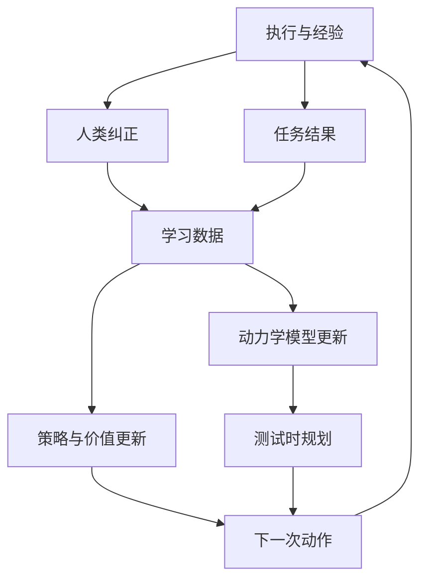

## 专题问题

一次机器人执行结束后，哪些信息可以让下一次做得更好？任务奖励、人类纠正、价值估计和模型预测扮演不同角色。这个专题按**信息如何进入学习与决策**组织论文。

> 以下横向关系是阅读者的研究整理，不表示论文之间存在直接继承，也不代表在统一基准上的性能排名。

## 三种闭环

| 比较维度 | HIL-SERL | π*₀.₆ / RECAP | TD-MPC2 |
| --- | --- | --- | --- |
| 重点问题 | 真机技能学习的效率 | 通用 VLA 的经验改进 | 连续控制的预测与规划 |
| 经验入口 | 演示、自主交互、干预 | 示范、策略采样、专家纠正 | 环境交互与回放数据 |
| 反馈角色 | 奖励与离策略价值学习 | 价值与优势条件 | 奖励、价值与潜动力学 |
| 动作选择 | 学习策略输出动作 | 条件动作模型输出动作 | 潜空间中的局部轨迹优化 |
| 应核算的成本 | 真机时间与人工干预 | 初始模型与数据系统 | 模型训练与在线规划计算 |

依据：[HIL-SERL 项目说明](https://hil-serl.github.io/)、[π*₀.₆ 论文](https://arxiv.org/abs/2511.14759)、[TD-MPC2 项目说明](https://www.tdmpc2.com/)。

## 把概念放回系统

这是一张**分析框架**：具体论文只使用其中一部分机制。读图时，应在论文或代码中找到对应模块，再判断哪些箭头有直接证据。

## 三个容易混淆的判断

**有人工干预，不等于策略已经学会恢复。** 需要在取消干预后，从同类偏离状态独立评测。

**加入失败数据，不等于自动获得强化学习改进。** 应查清失败结果怎样影响目标、权重或条件。

**有世界模型，不等于更适合所有控制场景。** 预测误差、规划延迟和真实环境失配，都可能抵消模型带来的收益。

## 如何做一次公平比较

先选定一个任务，固定观测、动作空间、数据预算和评测初态。将 BC 作为起点，分别加入纠正数据、任务结果信息或短时预测规划；每次只改变一个主要机制。共同记录成功率、失败恢复率、人工时间与推理延迟。

这是**拟开展实验**。此页不含实测结果，也不主张将简化实验称为原论文的完整复现。

## 推荐回看

- [HIL-SERL：人类纠正怎样成为学习信号](/papers/hil-serl.md)
- [π*₀.₆：价值与优势怎样连接到策略](/papers/pistar06.md)
- [TD-MPC2：预测怎样参与动作选择](/papers/td-mpc2.md)
- [实验工作台](/experiments/index.md)
